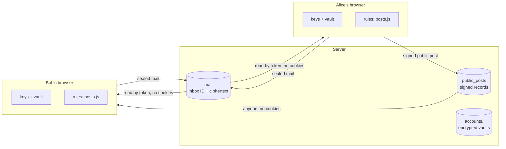
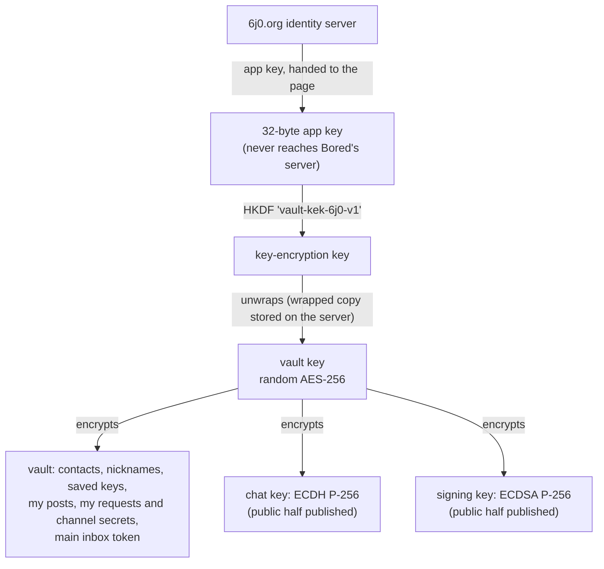
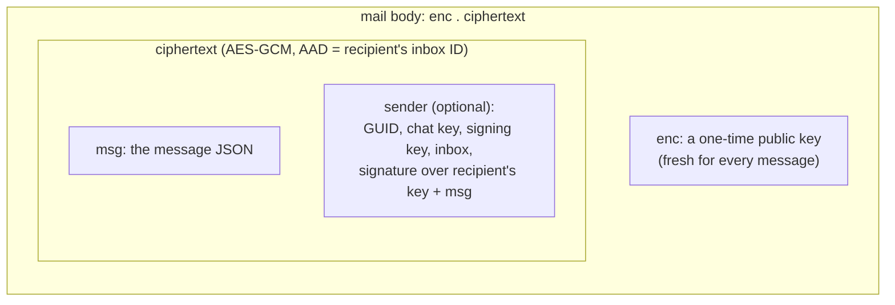
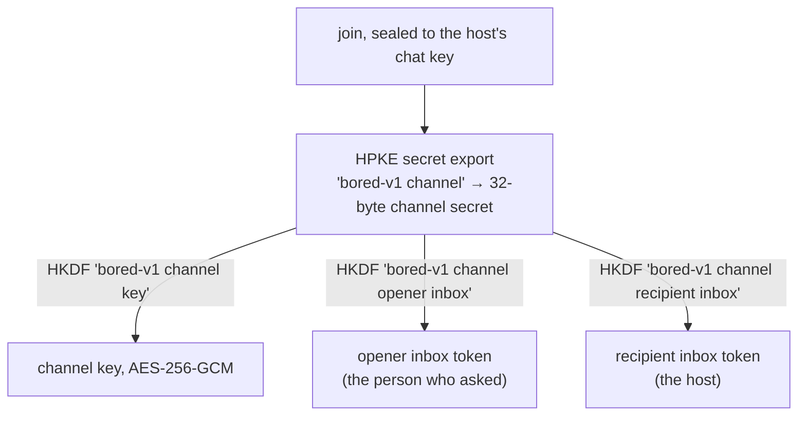
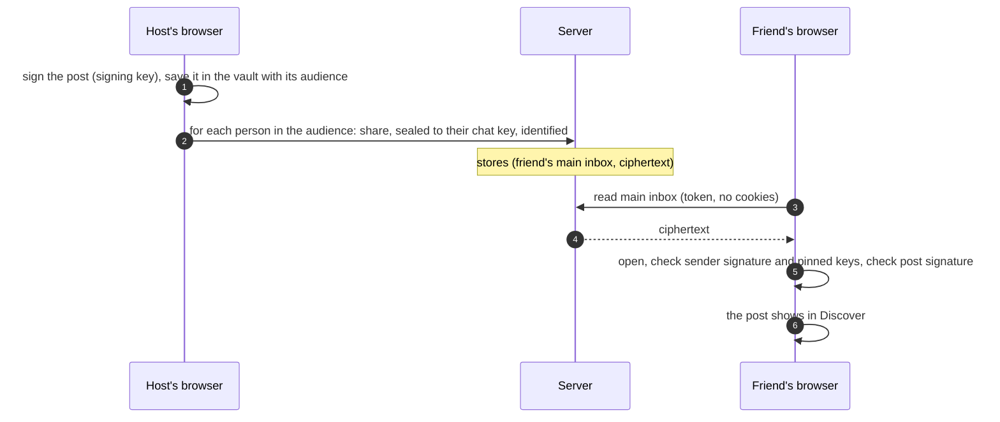
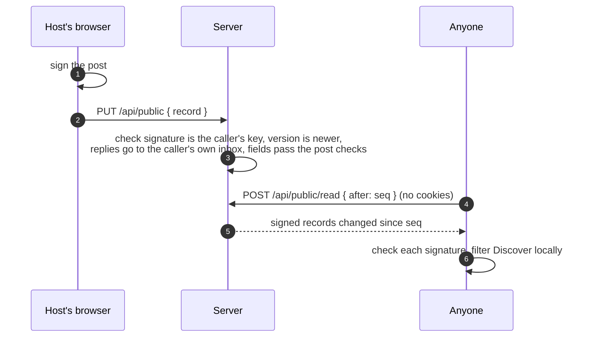
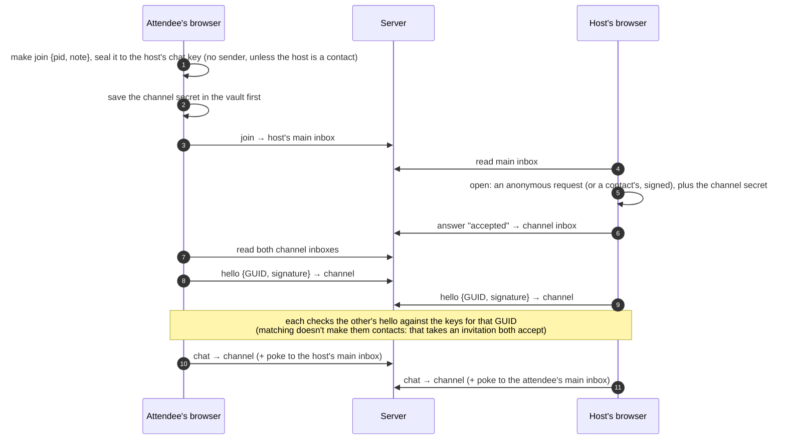
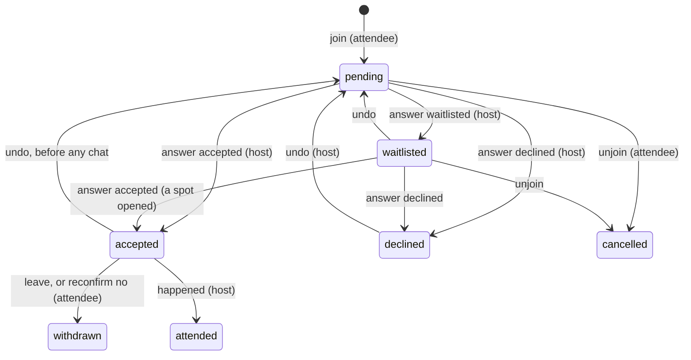

# How Bored keeps things private

This document explains how Bored encrypts and signs what people send each other, what the server can and can't
see, and why each part was chosen. It's for contributors, people running a server, and anyone who wants to check
our claims. The code is the final word; each section names the files to read.

## Contents

1. [Goals and threat model](#1-goals-and-threat-model)
2. [The big picture: the server is a mailbox](#2-the-big-picture-the-server-is-a-mailbox)
3. [Keys](#3-keys)
4. [Building blocks](#4-building-blocks)
5. [Inboxes](#5-inboxes)
6. [Flows](#6-flows)
7. [The rules live in every browser](#7-the-rules-live-in-every-browser)
8. [What the server sees](#8-what-the-server-sees)
9. [Choices we considered and didn't make](#9-choices-we-considered-and-didnt-make)
10. [Known limits](#10-known-limits)

---

## 1. Goals and threat model

Bored gets strangers and friends to meet in person, so the most sensitive thing it handles isn't any one message:
it's **who does what with whom**. The product brief's goal is that *the server's operator should not learn any user's
real name or social connections.*

What we protect against:

| Adversary | What we want |
|---|---|
| A curious or compromised **server operator**, or someone who steals the database | Can't read private posts, requests to join, answers, matches, waitlists, attendance, or chats. Can't tell who sent any message. Can't forge or change a post. |
| **Other users** | See only what's meant for them. A host doesn't learn who asked to join until they say yes, unless the person asking is already one of their contacts. Strangers can't link one person's requests together. |
| **Push services** (Google, Apple, Mozilla, Microsoft) | Can't read notifications. |
| **The network** | Nothing readable in transit (HTTPS, plus everything private is end-to-end encrypted anyway). |

What we **don't** protect against (see [Known limits](#10-known-limits)):

- A server that serves malicious JavaScript. This is the core weakness of every end-to-end encrypted web app.
- Someone who gets hold of your unlocked device, or your keys, later on (there's no forward secrecy yet).
- Timing and IP address analysis by the server.
- Public posts being public: they're readable by everyone, including the server, by definition.

## 2. The big picture: the server is a mailbox

Everything a person sends someone else is a sealed message dropped into an **inbox** on the server. The server
stores the inbox ID and the ciphertext, and nothing about the sender. Public posts are the one exception: they're
plaintext, but signed by their host so nobody, including the server, can fake or change one.

All the logic that used to run on a server (who's matched, who's on the waitlist, whether a post is full, filtering
Discover) runs in each browser, by replaying the messages it can read.

Why this shape: a server that only stores ciphertext filed under random IDs has much less to leak, to be compelled to
hand over, or to abuse. Moving the rules into the browser was the price: the server can no longer enforce them, so
every browser enforces them on what it reads instead (see [section 7](#7-the-rules-live-in-every-browser)).

## 3. Keys

Code: `public/secure.js` (key setup, the vault), `public/envelope.js` (using the keys).

Each account has:

- a **vault key**, random, AES-256-GCM. It encrypts everything private the account keeps.
- a **chat key** (ECDH P-256). Mail to this person is sealed to its public half.
- a **signing key** (ECDSA P-256). It signs public posts, shares of private posts, and the `hello` that reveals who
  someone is after a match.
- a **main inbox**: a random 32-byte read token, kept in the vault. Its SHA-256 is the inbox ID, which is public.

Why these choices:

- **A 6j0.org identity's app key.** However you signed in there (a passkey, or a username and password), the identity
  server hands the browser this app's own *app key*, and the key-encryption key is derived from that. Bored's server
  never sees the app key or the password. (Bored used to run its own passkeys, with a key-encryption key from their
  WebAuthn PRF output. That was removed.)
- **A random vault key, wrapped.** Wrapping one random key, instead of deriving the vault key straight from the app
  key, means the way you sign in can change without re-encrypting anything.
- **Private keys never leave WebCrypto in usable form.** After sign-in, the vault, chat, and signing keys are imported
  as **non-extractable** CryptoKeys and kept in IndexedDB, so a page reload doesn't need you to sign in again, and no script
  can read the raw key bytes out (it can only *use* them; see [limits](#10-known-limits)).
- **P-256 everywhere.** It's the one curve every WebCrypto implementation supports for both ECDH and ECDSA with
  non-extractable private keys. That rules out secp256k1 (Nostr's curve), which WebCrypto doesn't have at all, and
  avoided depending on X25519 and Ed25519, whose WebCrypto support arrived later and unevenly.
- **Separate keys for encrypting and signing.** Using one key for both is a classic mistake; two keys keep each one
  doing one job.
- **Contacts' keys are pinned on first use.** The first time the app needs a contact's keys it asks the server
  (`POST /api/keys`) and saves the answer in the vault. After that, it uses the saved keys, and a `hello` or share
  whose keys don't match is ignored, so the server can't quietly swap them later.

## 4. Building blocks

Code: `public/hpke.js`, `public/envelope.js`.

We wrote no cryptography of our own. Every primitive is a standard one from WebCrypto, and the one construction on
top, HPKE, is a published RFC we transcribed and check against the RFC's own test vectors. What's ours is only the
*message format*: which fields go where.

### 4.1 Signatures

ECDSA P-256 with SHA-256, over `"bored-v1 <kind>\n<text>"`. The `kind` (`post`, `sender`, `hello`) is a domain
separator: a signature made for one kind of thing can't be passed off as another. Signatures are the 64-byte r || s
form WebCrypto produces; the server checks public post signatures with `node:crypto` (`dsaEncoding: 'ieee-p1363'`).

### 4.2 Signed records

A signed record is `{ body, sig, signer }`: the JSON text, its signature, and the signer's public key. Public posts
are signed records, and so are private posts inside the shares that carry them.

### 4.3 Sealed envelopes (HPKE, the way gift wrap works)

To send something to a person, the app seals it with **HPKE** (RFC 9180), base mode, suite DHKEM(P-256, HKDF-SHA256),
HKDF-SHA256, AES-128-GCM.

- **The sender is hidden by default.** HPKE generates a fresh key pair for every message (the `enc` part), so the
  ciphertext says nothing about who made it. This is the same idea as Nostr's gift wrap (NIP-59) and Signal's sealed
  sender.
- **When the sender should be known** (sharing a private post), the inner message carries their public keys and a
  signature over *the recipient's chat key plus the message*. Including the recipient's key means the recipient can't
  forward the signed message to someone else and have it look like it was meant for them.
- **A request to join a stranger's post carries no sender at all**: that's what makes it anonymous. A request to a
  contact's post (one they shared, or a public post signed with a contact's key) carries the sender, so the host sees
  who it is; the host's browser names them only if they're in its contacts too and the keys match the saved ones.
- **The recipient's inbox ID is the associated data**, so the server can't move an envelope from one inbox to another.

Why HPKE: it's a standard (RFC 9180) for exactly this job, "encrypt to a public key", with a security proof and test
vectors. It runs on plain WebCrypto, keeping private keys non-extractable. And it has a **secret export**, which we
use for channels, below. We implemented it ourselves (about 150 lines) because the app has no bundler and the npm
HPKE packages come as many module files; `public/hpke.js` reproduces the RFC's appendix A.3 vectors exactly.

### 4.4 Channels

Every sealed envelope also gives sender and recipient a **shared secret**: HPKE's secret export,
`export("bored-v1 channel", 32)`. A request to join uses it to open a **channel** for everything that follows about that
request.

- Both sides get the same secret: the requester from sealing, the host from opening. Nothing else is exchanged.
- From it come the channel's AES key and **two inbox tokens**, one per side. Nobody but these two people can compute
  them, so the server sees two inboxes that belong to no account.
- The requester saves the channel secret in their vault; the host can always get it again from the `join` in their
  main inbox.

Why channels: sealing every reply with HPKE would work, but then the host would need to know the requester's chat
key, which would reveal who they are. A channel lets the two talk privately *before* either knows who the other is,
and a symmetric key per channel is cheap.

## 5. Inboxes

An inbox is a random 32-byte token. The server files mail under `SHA-256(token)` and hands it out to whoever shows the
token. So:

- **Writing** to an inbox needs only its ID. **Reading** needs the token.
- **Main inbox** (one per account): its ID is published (in `users.inbox_id`, and in public posts as the reply
  address). It receives shares of private posts, requests to join, and pokes.
- **Channel inboxes** (two per request): known only to the two people on the channel.
- **Mail is read without cookies** (`credentials: 'omit'` on `POST /api/mail/read`), so the session doesn't tie a read
  of a channel inbox to an account. (The IP address still could; see [limits](#10-known-limits).)
- **Sending needs a session**, for rate limits: 600 messages an hour per account, 60 to any one inbox. The counts live
  in memory only; mail rows have no sender column.
- **Pokes:** a message on a channel also drops a tiny sealed `poke` in the other side's main inbox (once known), which
  makes the server send that account's devices a push saying only "New activity".

## 6. Flows

Code: `public/mail.js` (sending and reading), `public/posts.js` (the rules).

### 6.1 A private post

Editing sends a new version (a higher `v`) the same way. Taking someone out of the audience sends them an `unshare`.
The newest version always wins.

### 6.2 A public post

The server checks the signature before storing, so a stolen session can't publish a post the account's own key didn't
sign. Browsers check it again, so a malicious server can't change a post either; it can only withhold or remove one.

### 6.3 Asking to join, the match, and chat

- **The host never learns who asked unless they say yes**, or the person asking is already a contact. Declined and pending requests from strangers stay anonymous for good.
- **The `hello` signs the claimed GUID and a hash of the channel secret**, so it can't be replayed on another channel,
  and it's checked against the keys pinned for that GUID.
- **Everything after the join** (answers, the waitlist, `update` and `reconfirm` after an edit, `leave`, `happened`,
  chat, and edits and deletions of chat messages) is a channel message. An edit or a `delete` names one of its
  sender's own chat messages by that sender's message counter, so every browser applies it to the same message, and
  nobody can edit or delete the other side's. Deleting hides the message's text in both browsers ("Message deleted"),
  but the server can't remove the original: it's still in the channel's mail, sealed so only the two people can read
  it, and a modified client could still show it.

### 6.4 The waitlist

When a post is full, saying yes to a request puts it on the waitlist (an `answer` of `waitlisted`). When someone drops
out, the host's browser sees the open spot when it next reads its mail and sends `accepted` to the first person on the
waitlist, first come, first served, by when their request arrived. It then publishes or re-shares the post with its new
status (open, full, or past).

## 7. The rules live in every browser

Code: `public/posts.js`.

The server can't read the messages, so it can't enforce the rules. Instead, `derive()` replays everything a browser can
read through the same state machine, and **anything the rules don't allow is ignored**. Both sides of a channel run the
same code on the same messages, so they reach the same state.

Every channel message carries:

- **`role`**: who sent it. A message whose type that side may not send is dropped, so neither side, nor the server, can
  make the host's answer appear to come from the attendee or the other way round, by reflecting it back.
- **`n`**: the sender's own counter (1, 2, 3, …). A missing number stops that side's messages there: a dropped message
  becomes visible instead of silently changing the outcome. The same number twice keeps one.
- **`seen`**: how many of the other side's messages the sender had seen. This gives both sides the same order for the
  two streams; when two messages crossed, the host's goes first.
- **`id`**: random, so copies and replays are recognized.

Why a replayed state machine rather than, say, signed state: it's simple, deterministic, and doubles as the spam filter.
A message that makes no sense at that point (an answer from the wrong side, a chat before a match) never changes
anything.

## 8. What the server sees

| Data | Server can read it? | Notes |
|---|---|---|
| Public posts | **Yes** | By definition. Signed, so it can't forge or change them; it can take them down. |
| Private posts | No | Sealed to each person they're shared with. |
| Who a private post is shared with | No | Only that some main inboxes got some mail. |
| Who asked to join a post | No | The request is sealed and anonymous. |
| Answers, waitlists, matches, attendance | No | Channel messages. |
| Chats | No | Channel messages. |
| Who sent any message | No | No sender column; HPKE's one-time key hides it. |
| Which session is sending, as it sends | Yes, in memory | For rate limits; never stored. |
| Inbox, time, and size of each message | **Yes** | Main inboxes belong to known accounts; channel inboxes don't. |
| IP addresses | **Yes**, in transit | Not stored by the app; a reverse proxy may log them. |
| Accounts, sessions, push subscriptions | Yes | Bored stores no names, emails, or passwords. A 6j0.org identity's passkeys and password stay on the identity server. |
| The vault | No | Encrypted with the vault key. |
| Invitation connections | **Yes** | Who connected with whom through an invitation link. Still plaintext (see `TODO.md`). |
| Your location (distance filter) | No | Stays in the browser; Discover filters locally. |
| Reports on public posts | **Yes**, as it arrives | Counted per post. Stored under a keyed hash of the account and the post, so the table alone is no list of who reported what, but the server holds the key and sees each one arrive. |
| Your moderation settings and who you've blocked | No | In the vault. Word filters and report thresholds are applied in the browser. |

## 9. Choices we considered and didn't make

**Nostr.** It's an appealing fit (signed events, relays, gift wrap), and our sealed envelope borrows gift wrap's shape.
We didn't build on it because:

- Its keys are secp256k1, which WebCrypto doesn't support, so private keys would have to live as raw bytes in
  JavaScript instead of as non-extractable keys.
- Its direct-message encryption (NIP-44) has no forward secrecy either, so it wouldn't fix our biggest limit.
- Public calendar events (NIP-52) on public relays can't be recalled once copied, which is a safety problem for posts
  about meeting in person.
- Running our own private relay would keep the drawbacks and lose the network.

Publishing public posts as NIP-52 events could come later, as an opt-in export.

**Signal protocol or MLS.** These give forward secrecy and post-compromise security, which we lack. But they need a
prekey server, careful state handling across devices, and, in a no-bundler web app, an implementation of our own or a
large dependency. We chose to ship standard, simple building blocks first, and keep a ratchet as the next step.

**One shared key per match (the earlier design).** Chats used to be encrypted with a key from ECDH between the two
people, but the server knew which two people each match was between, and who sent each message. Sealed envelopes and
channels remove both.

**A server that enforces the rules.** Simpler, but it would need to read the requests and answers. Moving the rules into
the browser was the whole point.

**Hiding public posts too.** A public post has to be readable by people the host doesn't know, so it has to be readable
by the server. Signing is what we can add: the server can't fake or change one.

## 10. Known limits

These are also tracked in `TODO.md`.

- **The server delivers the code.** A malicious or compromised server can serve JavaScript that uses the keys or reads
  plaintext. Fixes: reproducible signed builds with a verification extension, or native apps with signed updates.
- **No forward secrecy.** Leaking someone's chat key or vault exposes all their past and future mail. Fix: a double
  ratchet or MLS.
- **First-use key trust.** A contact's keys are pinned after first use, but the server could lie that first time.
  Fix: safety numbers to compare in person, or key transparency.
- **Either side of a channel can write as the other.** The channel key is shared. Role checks stop reflection, not a
  dishonest peer. Fix: per-side keys or per-message signatures.
- **The server can drop or delay mail.** A drop shows as a gap, but can't be recovered.
- **Metadata:** inbox, time, size, the sending session as it arrives, and IP addresses. Timing can link a send and a
  read.
- **No push before a match**, since channel inboxes aren't tied to accounts.
- **The waitlist moves only while the host's browser is open.**
- **Spam:** anyone can send requests to a public post's host. Rate limits and the browser's rules are the only defense.
  Blocking only catches requests from contacts, since a stranger's request is anonymous by design.
- **Reports reveal who reported.** Reporting a public post tells the server which account did it, as it arrives.
- **Public posts link to one host** through their signing key and reply inbox.
- **Invitation connections are plaintext.**
